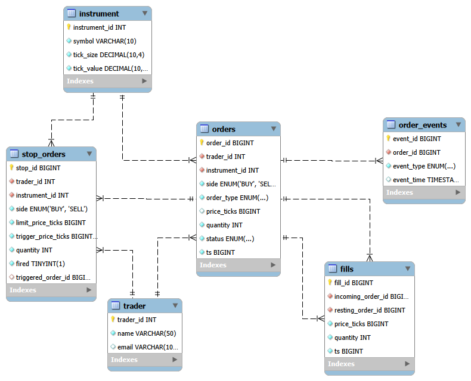

# Limit Order Book: DBMS Project

A limit order book is the list of buy and sell orders that an exchange matches against each other. This project stores that data in a relational database and shows it on a web dashboard. It was built as the DBMS project at MIT-WPU, Pune, for the LCA3 / CCA3 assessment.

- A **C++ matching engine** applies price-time priority: the best price trades first, and at the same price the earliest order goes first. It supports limit, market and stop orders, partial fills and cancels.
- A **MySQL database** stores traders, instruments, orders, fills, order events and stop orders, with keys, triggers, a stored procedure, a view and an index.
- A **Streamlit dashboard** shows the live order book, orders, fills, charts, the 8 report queries and the schema, and lets you place and cancel orders.

## Team members

| Name | Roll number |
|---|---|
| Aryan Chirawdiya | 1262242214 |
| Pranshu Verma | 1262241439 |
| Ayush Anand | 1262242977 |
| Lokesh Jangid | 1262241541 |

## Tech stack

| Layer | Technology |
|---|---|
| Matching engine | C++ (STL: `map`, `unordered_map`, `vector`) |
| Database | MySQL 8.0 |
| Dashboard | Python 3.12, Streamlit, pandas |
| Database driver | mysql-connector-python |
| Configuration | python-dotenv (`.env` file) |
| Tools | MySQL Workbench (ER diagram), mysqldump (backup), Git and GitHub |

## Database design



The design is in third normal form (3NF): no fact is stored twice. For example, `fills` has no instrument column, because the order it refers to already determines it.

| Table | What it holds | Primary key | Foreign keys |
|---|---|---|---|
| `trader` | Market participants | `trader_id` | none |
| `instrument` | Tradable securities, with `tick_size` and `tick_value` | `instrument_id` | none |
| `orders` | Every order: side, type, price in ticks (NULL for market orders), quantity, status, logical timestamp | `order_id` | `trader_id`, `instrument_id` |
| `fills` | One row per match | `fill_id` | `incoming_order_id`, `resting_order_id` (both to `orders`) |
| `order_events` | Audit log of status changes, written by triggers | `event_id` | `order_id` |
| `stop_orders` | Dormant orders waiting for a trigger price | `stop_id` | `trader_id`, `instrument_id`, `triggered_order_id` (nullable, to `orders`) |

There are 6 primary keys and 8 foreign keys. Prices are stored as whole numbers of ticks to avoid decimal rounding errors, and `orders.ts` is an integer logical clock that gives a deterministic time order.

### Database objects

- **3 triggers** write an audit row into `order_events` when an order is created or its status changes.
- **Stored procedure** `cancel_order(order_id)` cancels an order and refuses if it is already filled or cancelled.
- **View** `stop_orders_status` shows each stop order as fired or dormant.
- **Index** `idx_fills_price` on `fills(price_ticks)` speeds up price lookups. The dashboard's Fills page compares the `EXPLAIN` plan with and without it.

### Report queries (`sql/queries.sql`)

| Query | Question it answers | SQL concept |
|---|---|---|
| Q1 | VWAP per instrument | Joins and aggregation |
| Q2 | Cancel ratio per trader | `GROUP BY` with a conditional sum |
| Q3 | Price levels with high volume | `GROUP BY` and `HAVING` |
| Q4 | Stop order to triggered order to trader | `LEFT JOIN` across three tables |
| Q5 | Traders with above-average order count | Subquery inside `HAVING` |
| Q6 | Running traded volume | Window function `SUM() OVER` |
| Q7 | Trader ranking by filled volume | Derived table and `RANK() OVER` |
| Q8 | Orders that never traded | `NOT EXISTS` anti-join |

## Repository structure

```
dashboard/     Streamlit app (app.py), seed generator (gen_seed.py), connection test (db_test.py)
sql/           full_dump.sql (schema, triggers, procedure, view, index and data), queries.sql (the 8 reports)
src/, include/ C++ matching engine source and headers
docs/          ER diagram
Decisions.md   design decisions
```

## Setup and execution

### 1. Requirements

- MySQL Server 8.0 (window functions in Q6 and Q7 need 8.0 or later)
- Python 3.10 or later
- Git

### 2. Get the code

```
git clone <this repository's URL>
cd <repository folder>
```

### 3. Create the database and load the data

In Command Prompt, Git Bash or a Linux terminal:

```
mysql -u root -p -e "CREATE DATABASE lob_db;"
mysql -u root -p lob_db < sql/full_dump.sql
```

PowerShell does not support `<`. There, run the second command through Command Prompt: `cmd /c "mysql -u root -p lob_db < sql\full_dump.sql"`.

Check the load (expect 3011 orders, 2312 fills, 2 stop orders and 3 triggers):

```
mysql -u root -p lob_db -e "SELECT (SELECT COUNT(*) FROM orders) AS orders, (SELECT COUNT(*) FROM fills) AS fills, (SELECT COUNT(*) FROM stop_orders) AS stops, (SELECT COUNT(*) FROM information_schema.triggers WHERE trigger_schema='lob_db') AS triggers;"
```

### 4. Configure the connection

Create a file named `.env` in the project root (it is git-ignored, so your password is never uploaded):

```
DB_HOST=localhost
DB_USER=root
DB_PASSWORD=your_mysql_root_password
DB_NAME=lob_db
```

### 5. Install the Python packages

```
pip install streamlit mysql-connector-python pandas python-dotenv
```

### 6. Run the dashboard

From the project root:

```
python -m streamlit run dashboard/app.py
```

It opens at `http://localhost:8501`. Use the sidebar to switch between Order Book, Orders, Fills, Analytics, Reports, Schema and Manage.

## Known limitations

- The C++ engine and the database are not connected live. The data was produced with the engine's logic and loaded into MySQL.
- Placing an order in the dashboard stores it and logs a `NEW` event through the trigger, but it does not run matching.

## Possible next steps

- Let the engine write orders and fills straight into MySQL.
- Run matching when an order is placed in the dashboard.
- Add automated tests for the triggers and the stored procedure.
